::: questions 
- Is job wall-time the only way to study job performance?
- What are commonly used metrics to describe job performance?
- What are common workflows to evaluate performance?
- How can I find the bottlenecks in a given job?
:::

::: objectives
After completing this episode, participants should be able to …

- Create a comprehensive performance overview through dedicated tools.
- Explain the difference between sampling and tracing.
- Measure utilization and the impact of underlying hardware components.
- Determine if their job is affected by a typical performance bottleneck pattern.
:::


::: instructor
## Intention: Introduce third party tools for performance reports

Narrative:

- Scaling study, scheduler tools, project proposal is written and handed in
- Maybe I can squeeze out more from my current system by trying to understand better how it behaves
- Another colleague told us about performance measurement tools
- We are learning more about our application
- Aha, there IS room to optimize! Compile with vectorization


What we're doing here:

- Get a complete picture
- Introduce additional metrics / definitions, and popular representations of data, e.g. Roofline
- Relate to hardware on the same level of detail
:::

::: instructor
## TODO: Discuss requirements in more detail?
Dependent on the cluster config, some of these may have to be addressed?

```
cap_perfmon,cap_sys_ptrace,cap_syslog=ep
kernel.perf_event_paranoid
```
:::

::: instructor
## Prepare a reservation!

We'll have to run a couple of 20 minutes long `--exclusive` jobs here, so make sure enough resources are available for the exercise!
:::

Wall-time measurements with `time` do not tell us why exactly an application is slower than expected.
To learn more about the *why*, we have to measure our applications behavior in more detail and capture the utilization of underlying hardware.

::: instructor
## Know your tool!

We provide alternatives for this episode. Make sure to select the right one in your `config.yaml`.

*Linaro Forge Performance Reports* provides a good first performance overview, but is a commercial application that requires access to valid licenses.

Be aware of site-specific setups, e.g. limiting access to performance counters, offering non-standard Slurm options during `sbatch` submission, and how licenses are handled.
:::


::: callout
## The performance measurement tool

[*Linaro Forge Performance Reports*](https://docs.linaroforge.com/25.0.4/html/forge/performance_reports/index.html): A commercial sampling-based profiler that condenses the behavior of your job into a single-page performance overview, as an `.html` and a `.txt` file.

It requires a valid license. Reading some measurements may also require access to hardware performance counters, which some sites restrict or only grant for certain jobs (e.g. exclusive ones).

If something covered in this episode isn't available or looks different on your cluster, check your cluster documentation or ask your HPC support staff.
:::

Let us set up our performance measurement tool by running an example job with 8 cores.
To give the job enough work to be worth measuring, let's go with $2263 \times 2263$ pixels and `-spp=512`.


```bash
#!/bin/bash
#SBATCH --nodes=1
#SBATCH --partition=intelsr_devel
#SBATCH --ntasks=8
#SBATCH --cpus-per-task=1
#SBATCH --time=01:00:00
#SBATCH --exclusive

module purge
module load GCC/13.2.0 OpenMPI/4.1.6-GCC-13.2.0 CMake/3.27.6-GCCcore-13.2.0 Boost/1.83.0-GCC-13.2.0 libpng/1.6.40-GCCcore-13.2.0 LinaroForge/25.0.3-GCCcore-13.2.0-linux-x86_64

perf-report mpirun -- ./build/raytracer -width=2263 -height=2263 -spp=512 -threads=1 -png "img_${SLURM_JOB_ID}_$(date +%Y-%m-%d_%H%M%S).png"

```

We will call this job 1.
Note the use of `--exclusive` here, which books a whole node for the job.
This is important to make sure the performance measurements are not disturbed by concurrent jobs.

:::: challenge
## Exercise: Run a second job with `raytracer_float4`

Submit a second job using the `raytracer_float4` executable instead of `raytracer` — keep the resolution, `-spp`, core count and `--exclusive` request all the same as the original job.

We will call this job 2.
::::
::: solution

There are other binaries next to the `raytracer` example, called `raytracer_float4`, `_float8`, `_float16`.
We can start one of those in our job script instead:

```bash
#!/usr/bin/bash
#SBATCH --time=00:20:00
#SBATCH --partition=intelsr_devel
#SBATCH --ntasks=4
#SBATCH --nodes=1
#SBATCH --cpus-per-task=1
#SBATCH --exclusive

module purge
module load GCC/13.2.0 OpenMPI/4.1.6-GCC-13.2.0 CMake/3.27.6-GCCcore-13.2.0 Boost/1.83.0-GCC-13.2.0 libpng/1.6.40-GCCcore-13.2.0 LinaroForge/25.0.3-GCCcore-13.2.0-linux-x86_64

perf-report mpirun -- ./build/raytracer_float4 -width=2263 -height=2263 -spp=512 -threads=1 -png "img_${SLURM_JOB_ID}_$(date +%Y-%m-%d_%H%M%S).png"
```
:::

While the test jobs are running, let's look into the relationship between computer hardware architecture and performance.


## Hardware Architecture & Counters
Broadly categorized, a jobs performance is mostly dependent on

- **CPU utilization**, e.g. how quickly instructions can be send to the processor, how quickly and how much data can be read from memory, and the raw calculation capabilities of the CPU.
- **Memory utilization** may vary in terms of how much data is stored in memory, how often data in memory is written or read, and how quickly the data can be read and written to.
- **Disk input and output** affects jobs that work with amounts of data that exceed available memory capacities.
- **Network input and output** affects applications that rely on remote data, e.g. MPI applications that regularly share results between processes on multiple worker nodes.


{alt='Diagram to visualize the data hierarchy of CPU architectures. Network, local disks, memory, and CPU caches have decreasing amounts of storage capacity, but increasing bandwidths and shorter latencies. Calculations occur in CPUs, possibly in multiple CPU cores, which may have multiple threads each, and even apply vectorized instructions.'}

::: discussion
# Want to share an example?

Every job is limited by a contention point in the hardware.
Resolving one issue, e.g. too slow reading of data from disk, just shifts the contention point to a different location, e.g. waiting for calculations to finish in the CPU cores.
The absolute performance of the application is improved, but it will be always "slowed down" somewhere.

Did you experience a situation, where an application was clearly slowed down in some way?

What performance bottleneck scenarios can you imagine in the given hardware architecture sketch?
:::


### Measurement Workflows
To learn how applications utilize the computers hardware, we employ third party tools that read usage metrics from *performance counters*, often implemented either in the operating system kernels (software) or in hardware.

Dedicated performance measurement tools often employ similar methods and rely on the same sources of information, but they my focus on different issues and use different data processing and visualization methods.

In general there are two approaches to performance measurements:

1. **Sampling**: Read out performance counters and the application state at regular intervals during execution
1. **Tracing**: Record every event and operation that occurs

*Tracing* is exact and allows for a very detailed analysis.
On the other hand, it results in very large amounts of measurement data that even affects the applications performance during data collection.
It may be impractical in some situations.

*Sampling* on the other hand is less exact and results in a statistical description of the applications behavior.
Sampling has a smaller *measurement overhead*, but may suffer from, for example, slight mis-attributions of measurements to wrong sections of the code and fluctuating results between repeated measurements.

Measurement results are either stored and analysed in a *timeline*, or aggregated into a final measurement, often called a *profile*.

## General Report

Going back to the directory where you submitted your jobs, you will find the Performance Report output next to the regular Slurm logs. For each job there are two files, an `.html` and a `.txt` version. Their names follow the pattern `<executable>_<number of processes>p_<number of nodes>n_<date>_<time>`, for example `raytracer_8p_1n_2025-12-16_09-53.html`.

The `.txt` file can be read directly on the cluster, but the `.html` version has the better-rendered visualizations. Copy the `.html` files of both jobs to your local machine, so you can open them in a web browser such as Google Chrome. Open the downloaded files in your browser. Open the reports of both jobs, each in its own browser tab. Unless mentioned otherwise, we look at the report of Job 1 (`raytracer`) in the following sections. Job 2 (`raytracer_float4`) comes into play when we compare the two.

As a first step, to go beyond a wall-time analysis, we employ the measurement tool to produce a general overview of our applications behavior.
Here, we typically try to answer questions like:

- Are available CPU, memory, disk, and network capabilities utilized well?
- Dose the jobs performance depend on a particular hardware component?
- Is there an obvious contention point that could be eliminated?

### First Overview

At the top of the report, you find a summary of the job and the system it ran on:

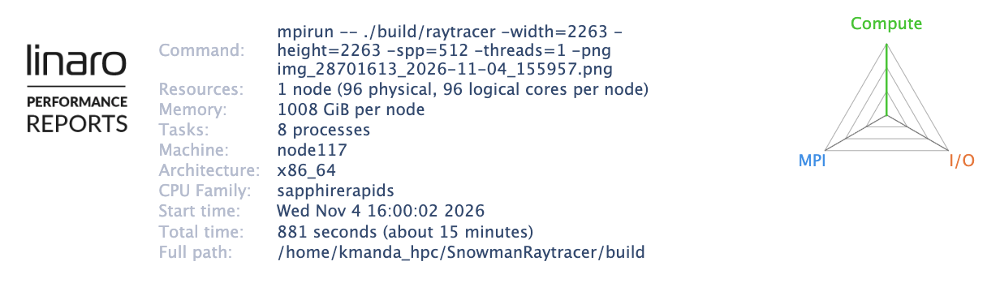{alt='Linaro perf-report job meta data'}

- **Allocated resources**: In our case $96$ cores and $1$ TiB of memory, since we requested the whole node with `--exclusive`, even though the application only uses $8$ of those cores.
- **System architecture**: Details about the hardware the job ran on, e.g. the processor model.
- **Runtime**: How long it took to run the workload.
- **Command**: The command that was used to launch the application, including its arguments.

This gives you a first understanding of the resources you requested, and a reminder of which application and which settings produced this report. That is especially useful when you compare several reports side by side.

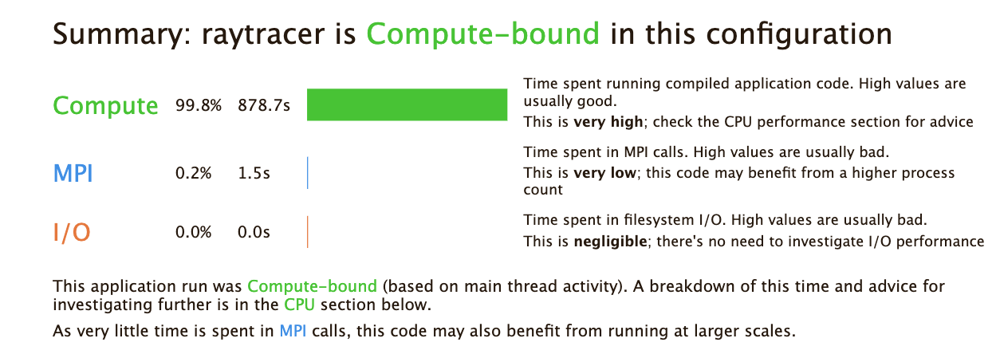{alt='Linaro perf-report overview'}

Below the job summary, the report shows a performance summary. It breaks the runtime down into three dimensions where a bottleneck could sit:

- **Compute**: Time spent on the cores, which covers both calculations (computational intensity) and memory access. Basically everything that happens at the core level.
- **MPI**: Time spent in MPI communication. This is relevant for us, because we launched a parallel program with `mpirun`.
- **I/O**: Time spent reading from or writing to the file system. Our application does not access the file system to read or write data during the run, so this dimension is irrelevant for us.

On this high level, the verdict for our job is that it is **compute-bound**.

:::: discussion
## What does compute-bound mean here?

Take a moment to think about what the report tells us with this verdict.


::: solution
**In general**, a job is compute-bound when its performance is limited by how fast the CPU can perform calculations, in other words by floating point operations. It is the opposite of memory-bound, where the job is limited by how fast data arrives from memory.

**In LinaroForge Performance Reports**, the term is broader. Here, "compute" covers everything that happens on the CPU, which includes both the calculations *and* the memory access. So a job marked as compute-bound can still be limited by memory access, and we need a closer look to tell the two apart.

What the verdict does tell us clearly is that we are not bottlenecked by MPI or I/O, so there is no point in optimizing those.
:::

::::

### CPU Metrics

CPU performance can be categorized in

1. *Front-end* utilization: preparation and scheduling of instructions of program code provided through the cache hierarchy
2. *Computation*: Arithmetic and logical operations with various data types, including the utilization of vectorized instructions, etc.
3. *Back-end* utilization: loading and storing of data in the cache hierarchy

The front- and backend hardware of a physical CPU core is often duplicated to implement *simultaneous multithreading* (SMT, also called hyperthreading).
Here, the arithmetic logical unit receives data and instructions from two independent threads to achieve a sufficient amount, which is a common limiting factor in everyday calculations.
On HPC systems, the benefit of SMT is very much application-dependent.
It is often disabled on HPC systems, since code is optimized to maximize computational intensity.


Performance Reports summarizes multiple CPU-related measurements.

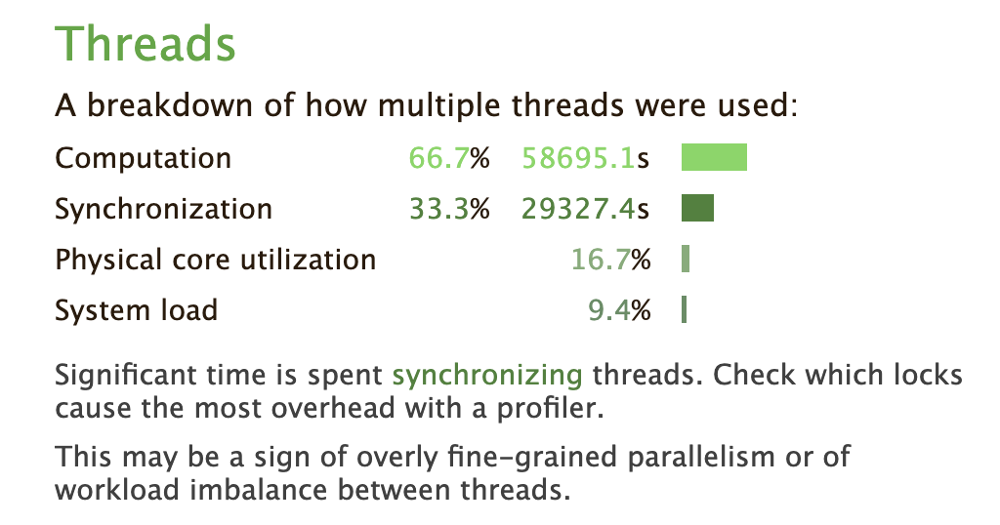{alt=''}

The **Threads** section tells us how the threads of our job spent their time and how well they used the physical cores of the node. First, the setup of our job, so we know what to expect:

- $8$ processes, with $1$ thread per process, so $8$ threads in total
- $96$ physical cores per node
- No SMT, so one thread per physical core at most

| Metric | Job 1 | What it measures |
|---|---|---|
| Computation | $66\%$ | Share of time the worker threads spend computing, rather than waiting in locks and synchronization |
| Synchronization | $33\%$ | Share of time the worker threads spend waiting in locks and synchronization primitives |
| Physical core utilization | $16.7\%$ | Percentage of the physical cores that are actively used by threads |
| System load | $9.4\%$ | Number of active (running or runnable) threads as a percentage of the physical cores in the node |

### Computation and synchronization

These two values add up to $100\%$ and describe what the threads do with their time. Here, about two thirds of the time goes to actual computation, and one third to waiting.

- **When computation is high**, the threads are mostly busy. The next step is the CPU breakdown: is that time spent well on floating point operations, or are the cores mostly waiting for memory accesses?
- **When synchronization is high**, the threads are waiting on each other, so the cores are not doing useful work. This is the place to look for load imbalance, lock contention, or too much communication.

### Physical core utilization and system load

Both values compare our job to the size of the node, so they are low whenever we use only a part of it. This is expected here: $8$ threads on a node with $96$ cores is only a small fraction of the node, which fits with both values being far below $100\%$.

- **Physical core utilization** counts only threads that are actively consuming CPU time at the same moment. Helper threads that mostly sleep are not shown. A value **above** $100\%$ means more threads are running than there are physical cores, so hyper-threading is in use. Since SMT is off here, we should never see this.
- **System load** counts running *and* runnable threads, which includes system processes and daemons, not only our application. A value **above** $100\%$ points to hyper-threading, oversubscribed cores, or other processes taking CPU time away from the job. A value **consistently below** $100\%$ means the job does not take full advantage of the CPU resources of the node.

:::: challenge
## Exercise: Where do you look next?

For each of the following Threads readings, decide what the finding suggests and where you would look next in the report.

1. Computation $95\%$, synchronization $5\%$, with physical core utilization and system load both close to $100\%$
2. Computation $40\%$, synchronization $60\%$
3. System load of $200\%$ on a node without SMT
4. Computation $66\%$, synchronization $33\%$, with physical core utilization and system load both below $20\%$ on a node where the job uses only a small part of the cores (like our Job 1)

::: solution
1. The threads are busy and the node is well filled. Nothing is wrong with the threading itself, so continue with the **CPU breakdown**: is the time spent on floating point operations, or are the cores waiting for memory accesses?
2. The threads spend most of their time waiting, not working. Look at **load balance** between threads and processes, and at the **MPI section** for communication that holds the processes up.
3. More threads are runnable than there are physical cores, which points to oversubscription. Without SMT it cannot be hyper-threading, so check for a **mismatch between the number of MPI processes or OpenMP threads and the resources requested from Slurm**, or for other processes on the node taking CPU time.
4. Both values compare the job to the size of the whole node, so they are low simply because we use only a small part of it. This is not a problem of the code itself. Check whether the job can use **more of the allocated cores**, or whether it should **request fewer**. The computation share still sends us to the **CPU breakdown**.
:::
::::

About two thirds of the thread time goes to computation, so this is where the report points us next: the **CPU** section. It shows both the floating point and the memory metrics, so we can see whether that computation time is spent on calculations or on waiting for memory accesses.

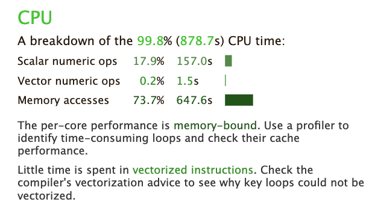{alt=''}

For Job 1, scalar numeric operations take up $17.2\%$ of the time, while memory access takes up $73.7\%$. So the time on the CPU is dominated by memory access.

The scalar operations are simple and regular ones, which makes them good candidates for vectorization. Why are we not getting more performance out of them by vectorizing the code? To find out, we look at Job 2 in the exercise below.

:::: challenge
## Exercise: Compare the CPU section of Job 1 and Job 2

Look at the performance report of Job 2. What is different in the CPU section compared to Job 1?

::: solution

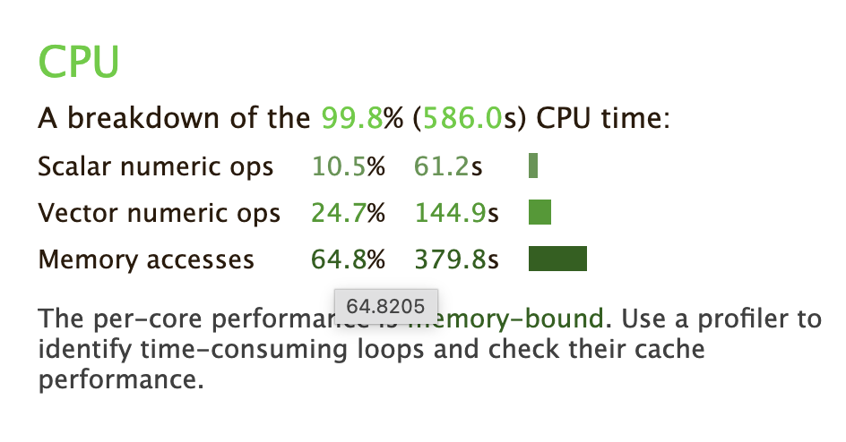{alt=''}

Job 2 now shows vector numeric operations at $24.7\%$, and the share of memory access dropped to $64.8\%$.
The wall time went down from $881$ seconds to $587$ seconds, which is about $1.5\times$ faster (the runtime shrank by a third).

The main reason is the vectorized operations: one instruction now processes several values at once, so the same work takes fewer instructions and less time.
:::
::::


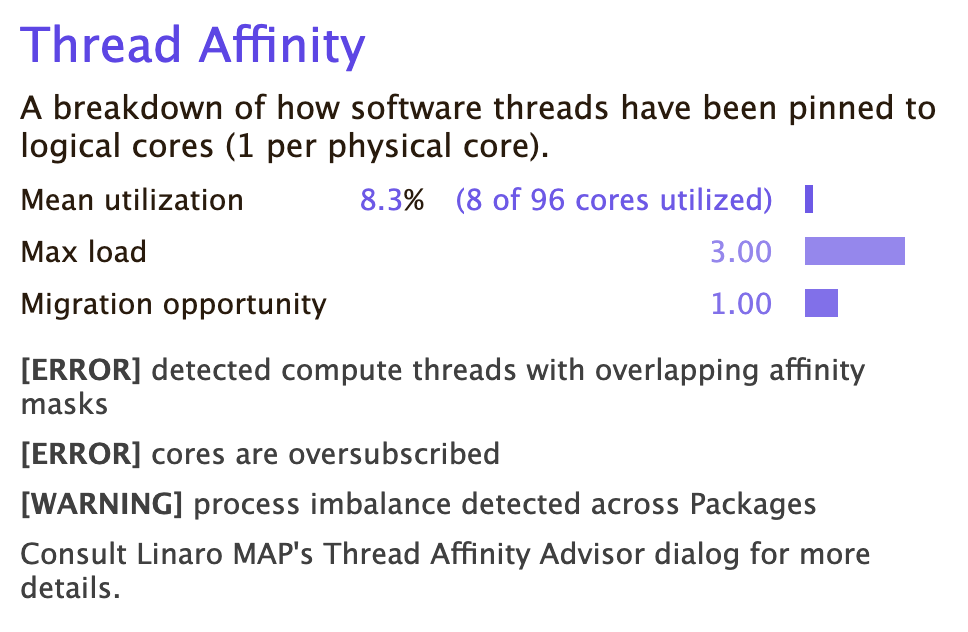{alt=''}

The **Thread Affinity** section shows how the threads of our job are pinned to the logical cores of the node.

- **Mean utilization** ($8.3\%$, $8$ of $96$ cores): the share of cores that our job is pinned to. It matches our setup of $8$ processes on a node with $96$ cores.
- **Max load** ($3.00$): the mean number of threads pinned to each core. Values above $1$ mean that threads may compete for the same core.
- **Migration opportunity** ($1.00$): the mean number of cores a thread may use. On a node without SMT, $1$ is the value we want, since a thread cannot be moved to another core.

This section is of minor importance for our job. The version of Performance Reports we use also has a bug in the thread affinity measurement, so treat these values with caution.

::: callout
## You do not need to be an expert to read this report

Performance Reports is beginner friendly. It gives a high-level overview and, when it flags something, it points to what to look at next, as it did with the compute-bound verdict above.

If you do not understand a metric, click on it to see a description of what it means.

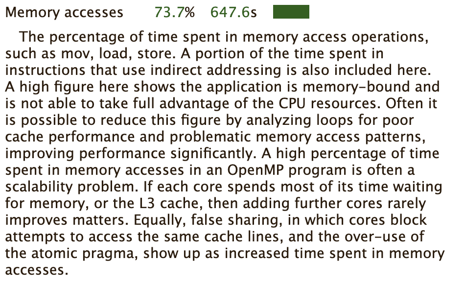{alt='Description of a metric shown after clicking on it in the Performance Reports'}
:::

### Memory

The **Memory** section summarizes how much memory our processes use.

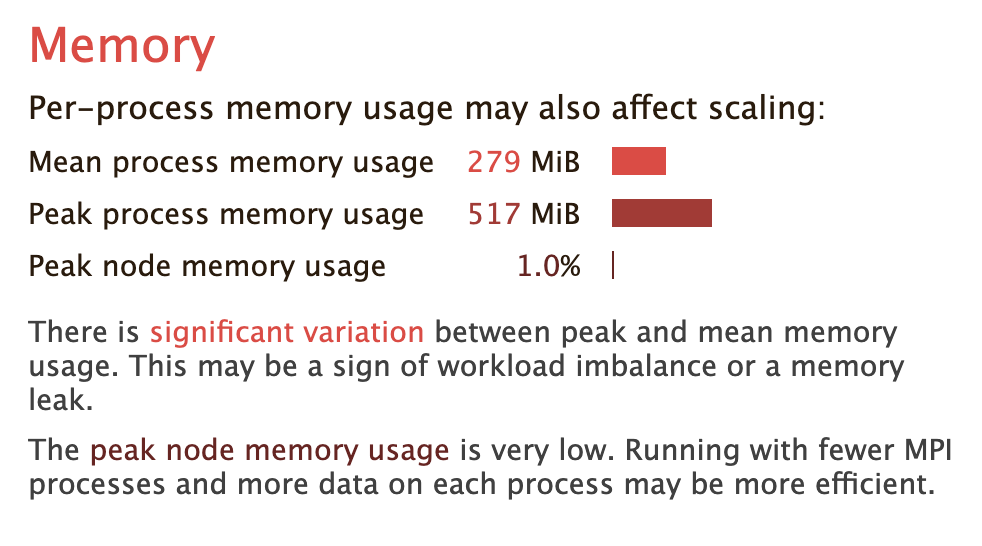{alt=''}

- **Mean process memory usage** ($279$ MiB): the average memory used per process over the whole job.
- **Peak process memory usage** ($517$ MiB): the highest memory usage seen by one process at any moment. A large gap to the mean can point to imbalanced work between processes, or to a memory leak. The value comes from sampling, so it could be during an instance of allocation.
- **Peak node memory usage** ($1.0\%$): the highest share of the node's memory in use at any moment. Values close to $100\%$ risk of  hitting system limits.

The report adds two remarks: the gap between peak and mean, and the very low node memory usage with the suggestion to run fewer processes with more data each. Neither matters for our job. The workload is a single $2263 \times 2263$ pixel image, which simply does not need much memory, and the suggestion to put more data on each process does not apply here. We do not follow up on this section.

:::: discussion
## Low memory usage, but most time in memory access?

Our job uses very little memory, yet the CPU section showed that most of its time goes to memory access. Is the job memory bound? What decides that? And what do we do with this information?

::: solution
- **Little memory used does not mean little time spent on memory.** The Memory section tells us how much memory the job occupies. The CPU section tells us how long the cores spend loading and storing data. Even a small data set can take a lot of that time.
- **Time spent is not the same as data moved.** Our job moves only a small amount of data, so it does not need much memory bandwidth. It can still spend a lot of time on memory access, for example waiting for data. So the job is not limited by memory bandwidth, even with a high memory access share.
- **FLOPs per byte decides.** A code is memory bound when it performs few floating point operations for each byte it loads, and compute bound when it performs many. Performance Reports does not report this ratio, only time shares.
- **Next, we look at how the data is accessed and stored, and at vectorization.** In Job 2, vectorization already reduced the memory access share from $73.7\%$ to $64.8\%$.
:::
::::

### Energy

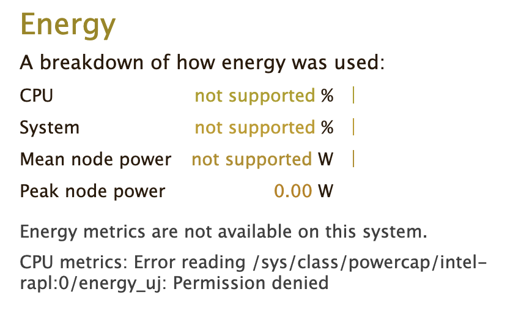{alt=''}

In cases where Performance Reports has user access to energy counters of the operating system, it can also summarize the CPUs and systems energy expenditure.
Here, we are unfortunately missing the required access to the systems "RAPL" interface.

Your HPC system may have a way to enable access to energy counters, e.g. for exclusive jobs.
Consult your clusters documentation or support for more information.


### Miscellaneous
Typically, many more measurements and perspectives on the data are available for each tool.

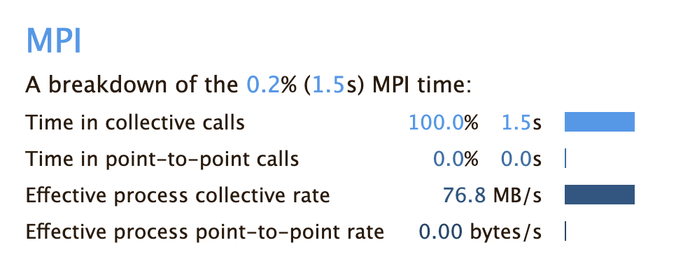{alt=''}
Performance Reports also summarizes the applications behavior in terms of MPI calls, e.g. time spent in collective calls involving all processors, or point-to-point communications.

In larger MPI applications, this can be of great help identify issues in MPI programming.
The example application has mostly independent MPI processes, where only initial data is scattered, and final results are gathered between processes.

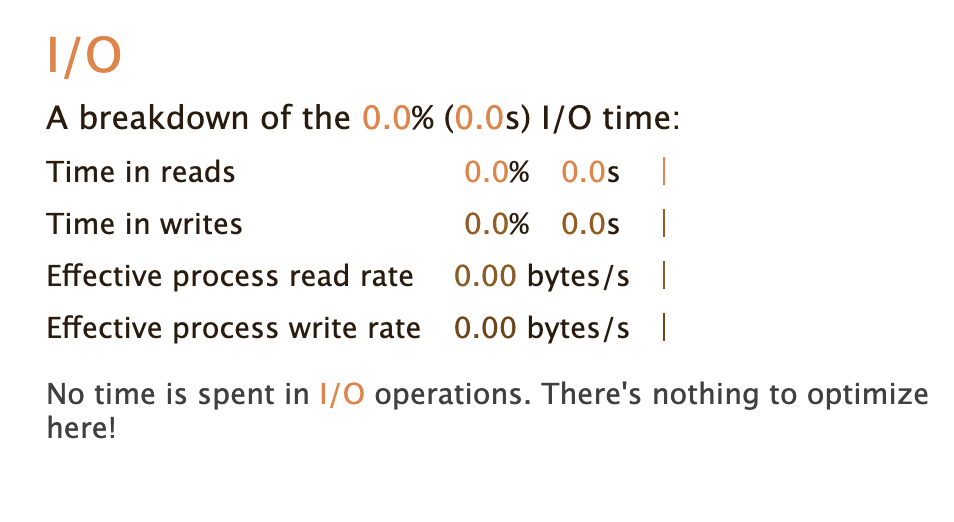{alt=''}
The I/O block summarizes measurements of interactions with the local file systems.
Here, no I/O operations are affecting the applications performance at all.

::: callout
## Take the suggestions with a pinch of salt

The report gives suggestions, but it does not know your application. For each one, check whether it applies to your case. The suggestions of the Memory section, for example, did not matter for our job. Others are very useful, like the hint to look at vectorization, which led to a clear speedup in Job 2.

If you know what is happening in your application, the report becomes much more useful, because you can tell which suggestions to follow.
:::


## How to identify a bottleneck?

:::::::::::::::::::::::::: instructor
## Intention: Uncover one or two issues in the application

What we're doing here:

- Where does our system choke?
- What's a bottleneck?
- How can we identify a bottleneck?
- "Online" and "after the fact" workflows of performance measurements (trace, accumulated results, attached to the process (live), or after it ran)
- Point to additional resources of common performance/bottleneck issues, e.g. on hpc-wiki

Maybe something like this already occurred before in 4. Scaling Study, or 5. Performance Overview

Summary could be:
- General advice on the workflow 
- Performance reports may provide an automated summary with recommendations
- Performance metrics can be categorized by the underlying hardware, e.g. CPU, memory, I/O, accelerators.
- Bottlenecks can appear by metrics being saturated at the physical limits of the hardware or indirectly by other metrics being far from what the physical limits are.
- Interpreting bottlenecks is closely related to what the application is supposed to do.
- Relative measurements (baseline vs. change)
   - system is quiescent, fixed CPU freq + affinity, warmups, ...
   - Reproducibility -> link to git course?
- Scanning results for smoking guns
- Any best practices etc.

:::::::::::::::::::::::::::::::::::::

:::: challenge
## Exercise: Match application behavior to hardware

Which parts of the computer hardware may become a point of contention for these application patterns:

1. Calculating matrix multiplications
2. Reading data from processes on other computers
3. Calling many different functions from many equally likely if/else branches
4. Writing very large files (TB)
5. Comparing strings for matches
6. Constructing a large simulation model
7. Reading thousands of small files for each iteration

Maybe not the best questions, also missing something for accelerators.

::: solution
1. CPU (FLOPS), maybe the cache hierarchy if matrix elements do not align well to cache sizes
2. I/O (network)
3. CPU (Front-End), difficult to prepare instructions in time
4. I/O (disk), bandwidth limited
5. CPU (Back-End), getting strings through the caches
6. Memory (capacity)
7. I/O (disk)
:::
::::


## Summary
Dedicated performance measurement tools are helpful to create reports of the general job behavior.
These tools either trace every event, or sample the application and hardware state at regular intervals.
Many tools are available, but some may have to be set up by the HPC system administrators, or rely on valid licenses.

The relationship between a job and the execution on physical hardware can become a very deep topic.
One of these topics is the correct mapping of job processes to the requested number of CPU cores, addressed in the next episode.

::: keypoints
- Performance tools measure data as regular samples or by tracing every event
- The data is either processed and visualized in a timeline or aggregated in a final profile
- Job performance relates closely to contention points in physical hardware
  - CPU utilization (front-end, ALU, back-end), multithreading, vectorization
  - Memory utilization (capacity, bandwidth, latency)
  - Disk I/O
  - Network I/O

:::
