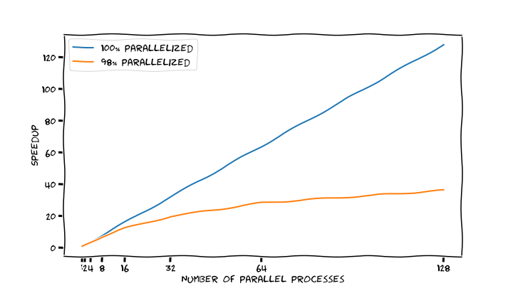
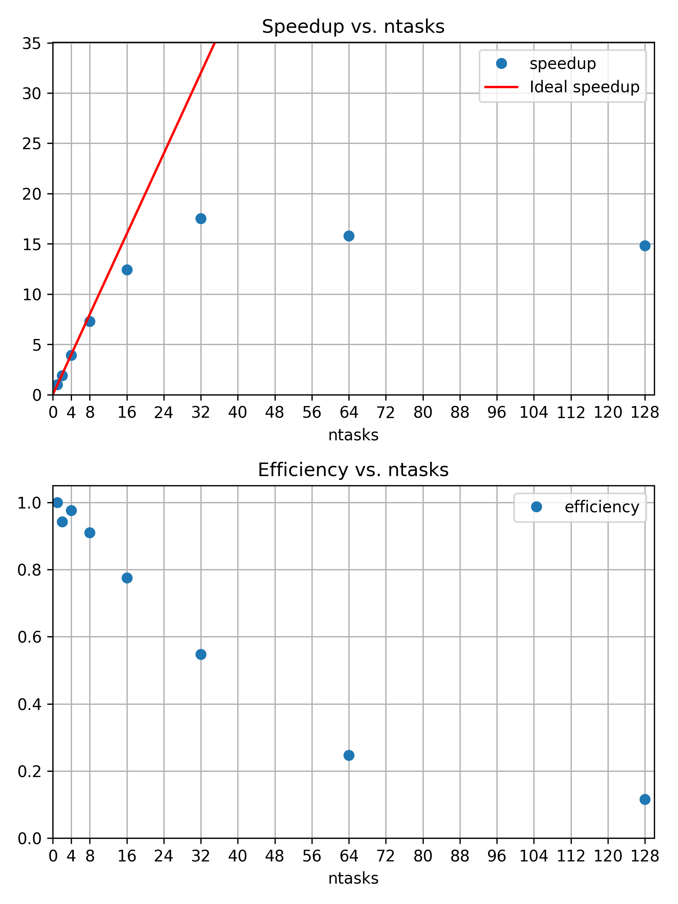
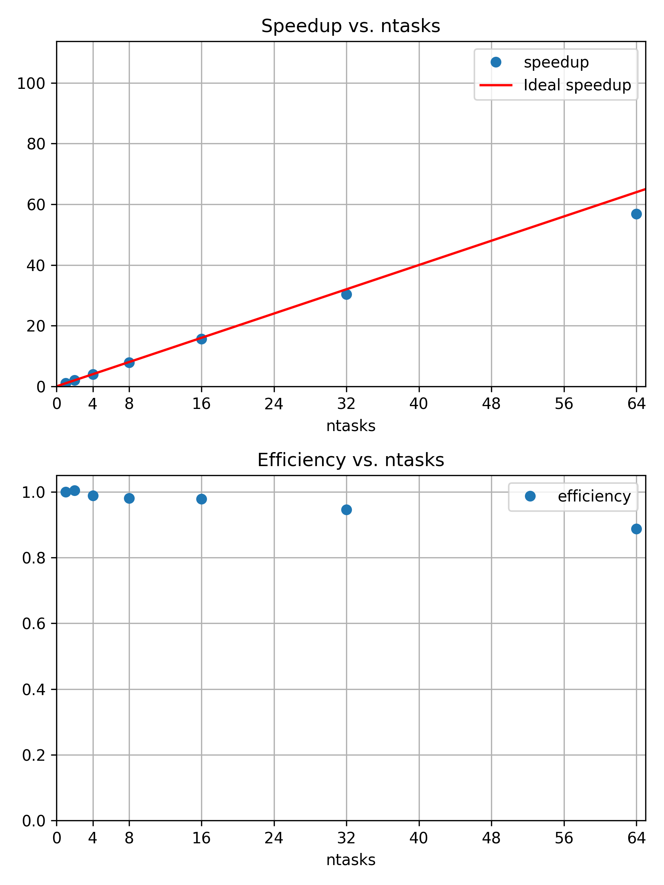

:::::::::::::::::::::::::::::::::::::: questions 

- How does our application behave as we increase computational resources?
- How can we determine whether an application benefits from additional resources?
- How many resources should we request for a given job?

::::::::::::::::::::::::::::::::::::::::::::::::

::::::::::::::::::::::::::::::::::::: objectives

After completing this episode, participants should be able to ...

- Explain the difference between strong and weak scaling.
- Perform a basic scaling study using Slurm.
- Calculate speedup and parallel efficiency from execution-time measurements.
- Interpret scaling results and identify diminishing returns.
- Evaluate scaling results and justify a suitable resource configuration for a
  representative workload.

::::::::::::::::::::::::::::::::::::::::::::::::


:::::::::::::::::::::::::: instructor
# Teaching Intention: Motivation for "Scaling"
In the previous episode, we explored how Slurm manages computational resources
and how we can inspect the resources allocated to our jobs.

We now take the next step: instead of only looking at the resources available to
us, we investigate how effectively our applications use them.

Imagine that a project deadline is approaching and our current image-rendering workload
is taking longer than expected.

- Would requesting more computational resources help us finish sooner?

To answer this question, we need to understand how our application behaves as we
increase the number of computational resources. This is the motivation behind a
scaling study.

During this episode, we will investigate two approaches:

- Strong scaling
- Weak scaling

The aim is not simply to use more resources. It is to identify a configuration that
provides useful performance improvements for our application and workload.
:::::::::::::::::::::::::::::::::::::

At times, you may find yourself thinking: "The deadline is approaching, and we may
not finish our project in time." Perhaps requesting more computational resources
through the cluster scheduler could help?

But how can we determine whether additional resources will actually improve application
performance, and by how much?

Answering this question can be an important part of preparing a compute-time application
for larger HPC systems. Computing centers may ask researchers to demonstrate that
their applications can make effective use of the computational resources they request.

That brings us to the concept of *scaling*.

To understand scaling, let us consider the following questions:

- How does our parallel application behave as the number of computational resources
  increases?
- Does its execution time decrease?
- Does it continue to benefit from additional resources, or do we eventually reach a point
  where adding more resources provides little or no improvement?

## What is Scaling?
In a scaling study, we investigate how an application's performance changes as we vary
the computational resources, the problem size, or both.

We will first keep the problem size fixed while increasing the number of parallel
processes. This approach is known as *strong scaling*.

Later, we will increase the problem size alongside the number of processes.
This approach is known as *weak scaling*.

In our strong-scaling experiment, we will use wall-clock execution time as the primary
performance metric. To make the measurements comparable, we should keep the application
version, input data, problem size, and relevant execution parameters unchanged while
varying the number of parallel processes. Ideally, we should also minimize interference
from other workloads running on the compute nodes.

This allows us to investigate how the execution time changes as we make additional
computational resources available to the application.

{alt="Sketched execution times for a perfectly parallelized application and a $98\%$ parallelizable application. When the number of parallel processes is doubled, execution time is halved in the perfectly parallel case, while the $98\%$ parallelizable application achieves a slightly smaller reduction."}

We will begin our scaling study using the job script `render_snowman.sbatch`:

In this example, we request one Slurm task for each MPI rank. With the default allocation
of one CPU per task, Slurm allocates one CPU for each requested task, and the MPI
launcher starts the corresponding number of processes within the allocation.

::: callout
In our MPI example, each MPI process has an identifier called its *rank*, which is
unique within its MPI communicator. We request one Slurm *task* for each MPI process.
:::

::: instructor
## Todo: Unify MPI and modules across examples
We should address the various ways to start MPI programs at first use and choose
a single way. Preparing the software is also cluster-specific (`module load ...`).

In the mid-/long-term this may call for a site-specific implementation of the course,
e.g. via the hpc-intro workbench.
:::

```bash
#!/usr/bin/bash
#SBATCH --time=01:00:00
#SBATCH --nodes=1
#SBATCH --mem-per-cpu=200MB

# The `module load` command you had to load for building the raytracer
module load 2025 GCC/13.2.0 OpenMPI/4.1.6 buildenv/default Boost/1.83.0 CMake/3.27.6 libpng/1.6.40

time mpirun -- ./build/raytracer -width=800 -height=800 -spp=128 -png "$(date +%Y-%m-%d_%H%M%S).png"
```

We can perform this scaling study by submitting multiple jobs, each requesting
a different number of Slurm tasks while keeping the problem size and other application
parameters unchanged. In this example, we do not explicitly specify the number of
MPI processes (ranks) using `-n` or `-np` when invoking `mpirun`. With the Open
MPI $4$ and $5$ configurations used in our environment, the MPI launcher can detect
the Slurm allocation and determine the number of processes to launch.

We use `--` to separate the arguments passed to `mpirun` from the MPI application (`raytracer`)
and its arguments. In this case, we do not pass any additional options to `mpirun`.

This separation is particularly useful for compatibility with some Open MPI $5$ configurations,
where application arguments might otherwise be interpreted as arguments to `mpirun`.

::: callout
# Scaling memory with the number of MPI processes
When we change the number of Slurm tasks at submission time, for example, using
`sbatch --ntasks=X ...`, we should also consider how other resource requirements
of our job are affected.

In this example, we request one CPU per Slurm task and use `--mem-per-cpu=200MB`.
Therefore, increasing the number of tasks also increases the number of allocated CPUs
and the total memory requested. In contrast, `--mem` requests a fixed amount of
memory per node, regardless of the number of MPI processes assigned to that node.

For example, if each MPI process requires approximately $100$ MB of memory, requesting
$2$ GB per node would provide a nominal memory allocation for approximately $20$
MPI processes.

> Failing to account for memory requirements when increasing the number of MPI processes
> is a common pitfall.

:::

Let us begin by measuring the execution time with $1$, $2$, $4$, and $8$ tasks:

```output
$ sbatch --ntasks 1 render_snowman.sbatch
Submitted batch job 16142767
$ sbatch --ntasks 2 render_snowman.sbatch
Submitted batch job 16142768
$ sbatch --ntasks 4 render_snowman.sbatch
Submitted batch job 16142769
$ sbatch --ntasks 8 render_snowman.sbatch
Submitted batch job 16142770
```

We have now submitted the same computational workload using four different numbers
of MPI processes. Once the jobs have completed, we can compare their execution times
to investigate whether increasing the number of processes reduces the time required
to render the image.

::: callout
# Watching the status of jobs using `squeue`
Use `squeue --me -i 30` to refresh the status of your jobs every 30 seconds.

If you don't need such frequent updates, it is good practice to use an interval of
around 30 seconds to a couple of minutes. This avoids making unnecessary queries
to the Slurm controller.
:::

Once the jobs have finished, we can use `grep "real" slurm-*.out` to retrieve the
wall-clock times reported by the `time` command:

```output
slurm-16142767.out:real       2m7.218s
slurm-16142768.out:real       1m7.443s
slurm-16142769.out:real       0m32.584s
slurm-16142770.out:real       0m17.480s
```

The execution time decreases as we increase the number of MPI processes. For these
initial measurements, doubling the number of processes reduces the execution time
by approximately half. This suggests that the application benefits from additional
parallel resources, at least for the configurations tested so far.

:::::::::::::::::::::::::: challenge
# Exercise: Continue the scaling study to larger values
Extend the scaling study by increasing the number of `--ntasks`, for example, to
$16$, $32$, $64$, and $128$.

So far, we have used `--nodes=1` to keep all MPI processes on a single node.

- How many CPUs are available to Slurm on a single node in your partition?
- How many MPI tasks can you request on a single node without oversubscribing its
  allocated CPUs?
- When would you need to request additional nodes?
- Do you need to increase the number of `--nodes` to run with larger numbers of tasks?

Use Slurm command-line tools to investigate the available resources. Gather your
`real` time measurements and store them in a `.csv` file. Here is an example containing
our previous measurements.

```csv
ntasks,time
1,127.218
2,67.443
4,32.584
8,17.480
...
```

- How much does each doubling of the number of MPI processes improve the execution
time of the parallel Raytracer?
- Does the improvement remain consistent as you increase the number of processes?

::: hint
Use `sinfo` to inspect the available node names in your Slurm partition. Then use
`scontrol show node=<NodeName>` to display detailed information about a particular
node. Look for the CPU-related information to determine how many CPUs Slurm makes
available on that node.
:::

::: solution
```csv
ntasks,time
1,127.218
2,67.443
4,32.584
8,17.480
16,10.251
32,7.257
64,8.044
128,8.575
```

Using `grep "real" slurm-*.out`, we can see that the execution time is almost halved
initially with each doubling of MPI processes. However, somewhere between $8$ and
$16$ processes, we start to see progressively smaller improvements.

Adding more computational resources does not improve performance indefinitely. At
some point, overheads associated with parallel execution can outweigh the benefits
of additional parallelism. Possible contributors include communication and synchronization
overhead, memory-bandwidth limitations, load imbalance, and contention for shared
resources. Further measurements are required to identify which factors are responsible
for the observed slowdown.

In other words, as we increase the number of MPI processes, the amount of work
assigned to each process may eventually become too small to justify the additional
overhead of parallel execution.

Beyond this point, adding more MPI processes may no longer improve
performance and can even increase execution time.
:::
::::::::::::::::::::::::::::::::::::

::: instructor
# Scaling Depends on the Cluster and Hardware
Scaling behavior depends on the interaction between the application, its workload,
and the hardware on which it runs. Consequently, results obtained on one cluster
cannot automatically be assumed to apply to another cluster.

Encourage learners to consider the following factors when comparing results:

- Network latency and bandwidth
- Memory bandwidth and cache behavior
- Process placement and CPU topology
- Communication and synchronization overheads arising from the algorithms and communication
  mechanisms used in the code
- Load imbalance between MPI processes
- Filesystem and I/O performance
- Contention from other jobs and shared resources

Emphasize that the experiment helps learners understand how the application behaves
on the tested system. The results should not automatically be generalized to other
clusters or hardware configurations.

Ask learners to distinguish between what their measurements demonstrate and what
they merely suspect might be responsible for the observed behavior.
:::

Adding more MPI processes can actually slow down a calculation beyond a certain
point. The optimal resource configuration differs between applications and depends
on the characteristics of the application and the computing environment. In particular,
it depends on the balance between computation, communication, synchronization, and
other overheads associated with managing parallel execution.

::: callout
# Overheads and Reliable Measurements
The impact of different overheads also depends on the underlying hardware. Consequently,
the optimal resource configuration may differ between clusters, even when the application
and its configuration remain unchanged.

For example, network communication introduces latency (the time required for data
to travel between communicating processes), while network bandwidth determines
how much data can be transferred over a given period. Clusters with different network
architectures and technologies can therefore exhibit different scaling behavior
and optimal resource configurations for the same application.

Another common issue concerns the reliability of our measurements.

So far, we have performed a single time measurement on a compute node that may be
shared with other jobs. What happens if another user runs an application that heavily
uses shared resources, such as the local disk or network interface?

In this situation, our measurements may become non-deterministic: running the same
experiment twice can produce significantly different execution times.

If you need more reliable measurements, for example, for a scientific publication,
requesting exclusive access to compute nodes using the Slurm `sbatch` option `--exclusive`
can help reduce interference from other jobs running on the same nodes. However,
this may result in longer queue times because fewer jobs share the allocated
nodes, even when your application does not use all their resources.

Even when using *exclusive nodes*, measurements cannot be expected to be perfectly
reproducible. For example, Linux kernel scheduling behavior and access to shared
external resources, such as parallel filesystems and remote data sources, can still
affect execution times.

For more reliable results, repeat measurements using the same configuration and
calculate their mean and standard deviation. The minimum measured time is also informative
because it indicates the best performance observed under the tested conditions.

Keep in mind that, depending on the Slurm configuration, `--exclusive` may allocate
all CPUs on a node to your job, even if your application uses only a subset of them.

Consequently, tools such as `seff` may report lower resource utilization because
utilization is evaluated relative to the resources allocated to the job.
:::

Scaling studies can also be performed by varying application and job parameters.

For example, how does the execution time change when we increase the *workload*,
such as by rendering a larger number of pixels, increasing the number of samples
per pixel, or using a more complex scene?

How does communication overhead change when we increase the number of nodes while
keeping the workload and number of MPI processes fixed? In this case, we change
how the MPI processes are distributed across the nodes, which can affect the communication
patterns and associated overheads.

Scaling studies like these can help identify performance bottlenecks and other factors
that limit application performance.

Scaling studies are typically performed during a *preparation phase*, in which an
application is evaluated using representative workloads and different resource configurations.
Once a suitable configuration has been identified, larger production calculations
can begin. This stage is often referred to as the *production phase*.

In a similar vein, demonstrating the scalability of an application can be a formal
requirement when applying for compute time on larger HPC systems. For large computational
campaigns, efficient resource utilization becomes particularly important because
computing resources can be highly contested, and the associated energy consumption
and carbon footprint can be substantial.

## Speedup, Efficiency, and Strong Scaling
To quantitatively study the scaling behavior of an application, we commonly examine
two metrics: *speedup* and *efficiency*. These metrics help us understand how much
performance improves as we increase the number of parallel processes.

*Speedup* compares the execution times obtained with different numbers of parallel
processes. It answers the question:

> How much faster does the application execute with $N$ parallel processes compared
> to an execution using a single process?

Parallel efficiency measures how closely the observed speedup approaches ideal linear
speedup. It is a measure of scaling effectiveness, not a direct measurement of CPU
utilization.

{alt="Sketched speedup for a perfectly and $98\%$ parallelized application. Doubling the number of parallel processors makes the perfectly parallel application twice as fast. The $98\%$ parallelized application does not speed up at the same rate."}

Speedup is defined as the ratio of the execution time using a single process to
the execution time using $N$ parallel processes: $$S(N) = \frac{T(1)}{T(N)}$$

Here, $T(1)$ is the execution time for the workload using a single process, and
$T(N)$ is the execution time using $N$ parallel processes.

For our Raytracer, with $2$ processes, we observe a speedup of:
$$S(2) = \frac{127.218}{67.443} \approx 1.89$$

In other words, the application runs approximately $1.89$ times faster when using
$2$ parallel processes than when using a single process. Ideally, we would expect
a speedup of $2$, meaning that doubling the number of processes would halve the
execution time.

However, our measured speedup is slightly below this ideal value. This indicates
that the application does not achieve ideal linear scaling. We can quantify how
closely the application approaches ideal linear speedup using *parallel efficiency*.

It is defined as the ratio of the observed speedup to the ideal linear speedup:
$$\eta(N) = \frac{S(N)}{N}$$

For our Raytracer, with $2$ processes, we observe a parallel efficiency of:
$$\eta(2) = \frac{\frac{127.218}{67.443}}{2} \approx 0.943 \approx 94.3\%$$

This means that the application achieves approximately $94\%$ of the ideal linear
speedup when using two parallel processes.

{alt="Sketched efficiency for a perfectly scaling application and an application with $98\%$ parallelizable work. The perfectly scaling application maintains $100\%$ efficiency as the number of parallel processes increases, while the efficiency of the $98\%$ parallelizable application gradually decreases."}

::: challenge
# Exercise: Calculate Speedup and Efficiency
Extend the `.csv` file containing your measurements from above with `speedup`
and `efficiency` columns.

It may look like this:

```csv
ntasks,time,speedup,efficiency
1,127.218,1.00,1.00
2,67.443,1.89,0.94
4,32.584,3.90,0.98
8,17.480,7.28,0.91
...
```

You may want to use any data visualization tool, such as Python or a spreadsheet
application, to visualize the results.

What number of MPI processes would provide a reasonable *working point* for the Raytracer
with an image resolution of $800 \times 800$ pixels and $128$ samples per pixel?

::: callout
# (Optional) Recommended for using Python plotting scripts
Save your strong-scaling measurements as `strong.csv` and your weak-scaling measurements
as `weak.csv` so that they can be processed by the supplied plotting script.
:::

::: solution
For all our measurements, the speedup and parallel efficiency values are:

```csv
ntasks,time,speedup,efficiency
1,127.218,1.00,1.00
2,67.443,1.89,0.94
4,32.584,3.90,0.98
8,17.480,7.28,0.91
16,10.251,12.41,0.78
32,7.257,17.53,0.55
64,8.044,15.82,0.25
128,8.575,14.84,0.12
```

Plotting the speedup and efficiency helps us identify a reasonable working point:

{alt="Speedup and parallel efficiency as functions of the number of MPI processes in a strong-scaling study"}

The configuration with $16$ MPI processes still achieves approximately $78\%$
parallel efficiency, with a speedup of approximately $12.41$. The corresponding
speedup is below the theoretical optimum, which is represented by a red line with
a slope of $1$ in the speedup plot.

There is no single optimum configuration, and the choice of a working point is open
for discussion.

For example, $16$ processes may be a reasonable compromise between execution time
and resource utilization.

Increasing the number of processes to $32$ reduces the execution time further, but
the parallel efficiency drops to approximately $55\%$, with a speedup of approximately $17.53$.

For this workload and the hardware used in our experiment, $32$ MPI processes achieve
the shortest measured execution time among the configurations tested.

At $64$ and $128$ processes, the execution time increases, indicating that additional
resources no longer improve performance. However, $16$ processes may be a more reasonable
working point when resource efficiency is also important, as this configuration
retains approximately $78\%$ parallel efficiency while still providing a speedup
of approximately $12.41$.
:::
:::::::::::::

:::::::::::::::::::::::::: discussion
# Discussion: Why Does Parallel Efficiency Decrease?
Adding more computational resources does not always make our application run faster.
What are some possible reasons why speedup and parallel efficiency may decrease
as we increase the number of parallel processes or threads?

Briefly collect and discuss the possible reasons.

- At $32$ MPI processes, the Raytracer completes in $7.257$ seconds.
- At $64$ MPI processes, the execution time increases to $8.044$ seconds.

1. What changed between these two configurations?
2. What does the measurement tell us about application performance?
3. What possible factors could explain the slowdown?
4. What additional measurements would help us identify the cause?

::::::::::::::::::::::::::


::: spoiler
# (Optional) Plotting our `.csv` files
If you have experience with python, you can use our
[Python script](files/plot_scaling_from_csvs.py) to create the same plots as above,
but using your own data.

The script depends on `numpy`, `pandas`, and `matplotlib`, so make sure to prepare
a corresponding Python environment.

> The script expects your `.csv` files to be named `strong.csv` and `weak.csv` and
> to be placed in the same directory.

:::

So far, we kept the workload size fixed at $800 \times 800$ pixels and $128$ samples
per pixel, using the same scene with three snowmen. The diminishing returns we
observe when adding more parallel processes lead us to a famous observation known
as *Amdahl's Law*.

Amdahl's Law states that the speedup achievable through parallelization is limited
by the fraction of the application that must be executed serially and cannot be parallelized.

Many applications contain both serial and parallelizable sections. Consequently,
increasing the number of parallel processes can accelerate only the portion of
the workload that can be executed concurrently.
Under the assumptions of Amdahl's Law, as the number of processes approaches infinity,
the execution time approaches the time required to execute the serial fraction alone.

Strong scaling describes how an application's execution time changes as we increase
the number of computational resources while keeping the problem size fixed.

The measurements from our strong-scaling experiment illustrate this behavior. To
understand why the benefits of additional parallelism become limited, we can use
Amdahl's Law.

::: callout
# Amdahl's Law[^AmdahlsLaw]
{alt="The model behind Amdahl's Law: An application consists of serial sections, such as initialization, and parallelizable sections, such as calculations in a loop. Both fractions add up to the entire program, i.e., $s + p = 1$. Speedup through parallelization is inherently limited because only the parallelizable fraction can be accelerated."}

The speedup achievable through parallelization is limited by the fraction of the
execution time that must remain serial. This idealized model assumes that the parallelizable
portion of the workload is divided evenly among the processes and does not account
for additional overheads introduced by parallel execution. Assuming that the execution
time using a single process is normalized to $1$, the execution time using $N$ parallel
processes can be expressed as: $$T(N) = s + \frac{p}{N}$$.

Here, $s$ is the serial fraction and $p$ is the parallelizable fraction of the application's
original execution time, with $s + p = 1$.

The speedup $S(N)$ is therefore defined as:

$$
S(N) = \frac{T(1)}{T(N)} = \frac{1}{s + \frac{p}{N}} \Rightarrow \lim_{N \rightarrow \infty} S(N) = \frac{1}{s}
$$

In other words, if the serial fraction accounts for only $1\%$ of the application's
execution time, the theoretical maximum speedup is: $$S_{\max} = \frac{1}{s} = \frac{1}{0.01} = 100$$

This means that, even with an arbitrarily large number of parallel processes, the
speedup cannot exceed a factor of $100$ under the assumptions of this model.

> In our Raytracer experiment, the decreasing parallel efficiency at higher process
> counts illustrates why the execution time of a fixed-size workload cannot be reduced
> indefinitely by adding more processes.

:::::::::::

:::::::::::::::::::::::::: discussion
# Discussion: When Should We Stop Adding MPI Processes?
Discuss your previous results and decide on a reasonable working point for the Raytracer.

- At what number of MPI processes do additional resources provide diminishing returns?
- At which point do the performance improvements become too small to justify allocating
  additional MPI processes?
- What other factors could influence your decision, such as available hardware resources,
  resource utilization, and expected queue waiting times?
::::::::::::::::::::::::::::

:::::::::::::::::::::::::: instructor
# When should we stop adding MPI processes?
The learners should realize that there is a point of diminishing returns when adding
more parallel processes. Where exactly to draw the line is debatable and depends
on the application and the available resources.

In the previous example, $N = 32$ appears to be a reasonable working point: it achieves
the highest measured speedup, with a parallel efficiency of approximately $55\%$.

However, $N = 16$ is also a reasonable choice if resource efficiency is more important
than achieving the shortest execution time. It achieves approximately $78\%$ parallel
efficiency, with a speedup of approximately $12.41$.

There are many reasons why using a large number of parallel processes may result
in lower speedup and parallel efficiency. These include I/O overhead, communication,
and synchronization between processes, limited parallelism in the workload, and
load imbalance. As the number of processes increases, the amount of work assigned
to each process may become too small to justify the additional overhead.
::::::::::::::::::::::::::

## If Strong Scaling Is Limited, Why Are There Larger HPC Systems? Weak Scaling!
For a fixed problem size, we observed that adding more parallel processes can only
improve performance up to a certain point. But what if the project benefits from
increasing the workload size, i.e., by performing *more calculations*?

For example, could a higher image resolution, more samples per pixel, or a more
complex scene improve the quality and detail of our results?

In this case, our perspective changes. Instead of solving the same problem faster,
we aim to solve a larger problem as we increase the number of parallel processes,
while keeping the amount of work per process approximately constant. For our Raytracer
example, increasing the workload corresponds to rendering more pixels, increasing
the number of samples per pixel, and/or using a more complex scene.

*Weak scaling* describes the scaling behavior of an application when the workload
increases proportionally with the number of parallel processes. In other
words, we aim to keep the amount of work per processing unit approximately constant
as we increase the number of parallel processes $N$.

::: callout
# The Difference Between Strong and Weak Scaling
In our previous discussion of Amdahl's Law, we kept the total amount of work fixed
while increasing the number of parallel processes $N$. Now, we are transitioning
to a different perspective where we increase *both* the total amount of work and
the number of parallel processes $N$.

In the former case (strong scaling), we eventually reach a point where adding more
parallel processes provides diminishing returns and may no longer improve performance.

In the latter case (weak scaling), we aim to solve increasingly larger problems by
using more parallel processes while keeping the workload per process approximately
constant. This allows us to make use of much larger HPC systems, potentially with
thousands of parallel processes!
:::

To scale the workload of the Snowman Raytracer, we can increase the number of calculated
pixels by the same factor as the number of parallel processes. For one process, we
have an image resolution of $800 \times 800$, corresponding to $640000$ pixels.
For two processes, we therefore need to double the number of pixels to $1280000$.
To maintain a square image, we calculate the required width and height as:
$\sqrt{2 \times 640000} = 1131.371 \approx 1131$.

Thus, for two processes, we use an image resolution of approximately $1131 \times 1131$ pixels.

Because image dimensions must be integers, the resulting pixel counts are not exactly
proportional to the numbers of MPI processes. However, the differences are small
enough for this experiment to provide a useful approximation for weak scaling.

We apply the same approach for larger numbers of processes. For example, with four
processes, we use an image resolution of $1600 \times 1600$ pixels.

Assuming that the Raytracer distributes the rendering workload approximately evenly
across MPI processes, increasing the image dimensions in this way keeps the number
of pixels processed per process approximately constant. This allows us to investigate
the weak-scaling behavior of the Raytracer.

The job script could look like this:

```bash
#!/usr/bin/bash
#SBATCH --time=01:00:00
#SBATCH --nodes=1
#SBATCH --mem-per-cpu=3800MB

module load 2025 GCC/13.2.0 OpenMPI/4.1.6 buildenv/default Boost/1.83.0 CMake/3.27.6 libpng/1.6.40

# Create associative array: define image dimensions for each supported task count
declare -A pixel
pixel[1]="800"
pixel[2]="1131"
pixel[4]="1600"
pixel[8]="2263"
pixel[16]="3200"
pixel[32]="4525"
pixel[64]="6400"

time mpirun -- ./build/raytracer -width=${pixel[${SLURM_NTASKS}]} -height=${pixel[${SLURM_NTASKS}]} -spp=128 -threads=1 -png "$(date +%Y-%m-%d_%H%M%S).png"
```

::: spoiler
# Different Ways of Scaling Workloads: Samples per Pixel (spp)

In each scaling study, it is important to identify which application parameters
affect the execution time. Often, there are several ways to increase the computational
workload.

For the Snowman Raytracer, instead of increasing the total number of pixels, we
can increase the number of *samples per pixel* (`spp`) proportionally to the number
of parallel MPI processes (`${SLURM_NTASKS}`). We start with `-spp=128` for a single
process. With one MPI process, the entire $800 \times 800$ pixel image is rendered
using $128$ samples per pixel.

When running with two MPI processes, each process is responsible for approximately
half of the pixels. However, we double the number of samples per pixel to $256$.
This means that each process performs approximately the same amount of work as the
single process did previously, while the total computational workload doubles.

The job script could look like this:

```bash
#!/usr/bin/bash
#SBATCH --time=01:00:00
#SBATCH --nodes=1
#SBATCH --mem-per-cpu=500MB

module load 2025 GCC/13.2.0 OpenMPI/4.1.6 buildenv/default Boost/1.83.0 CMake/3.27.6 libpng/1.6.40

SPP=$((SLURM_NTASKS * 128))

time mpirun -- ./build/raytracer -width=800 -height=800 -spp=${SPP} -threads=1 -png "$(date +%Y-%m-%d_%H%M%S).png"
```

{alt='Three snowmen rendered at $800 \times 800$ with $128$ samples per pixel'}

{alt='Three snowmen rendered at $800 \times 800$ with $8192$ samples per pixel'}

When comparing the two images closely, for example in the shadows, we can observe
more noise in Figure 1 than in Figure 2. Increasing the number of samples per pixel
improves the rendering quality, but it also increases the computational workload
substantially.

In this example, increasing the number of MPI processes from $1$ to $64$ also increases
the number of samples per pixel from $128$ to $8192$. This represents a $64$-fold
increase in the total number of samples per pixel and consequently, the total numbers
of samples.

Is this improvement in image quality worth the additional computational effort?
At some point, the improvement may become too small to justify the additional resources.

For this particular workload, increasing the image resolution may be a more useful
way to scale the problem than increasing the number of samples per pixel.

Ultimately, the usefulness of additional computation can only be determined in the
context of the scientific goals and the quality of the results required.
:::

Increasing the resolution may be worth the effort if we have a use for a larger,
more detailed picture. In practice, there is a point beyond which no meaningful
improvement can be expected. This is a question of accuracy, error margins, and
overall quality, which can only be answered in the specific context of each research
project.

If increasing the workload provides no tangible benefit, running with a larger number
of parallel processes does not serve a purpose, even if the application still exhibits
good *weak-scaling efficiency*.

When we increase the workload proportionally to the number of parallel processes
$N$, our weak-scaling speedup is defined as:
$$S_{\text{weak}}(N) = \frac{T(1)}{T(N)} \times N$$

Here, we perform $N$ times more work using $N$ processes compared to our reference
execution, $T(1)$.

The corresponding weak-scaling efficiency is defined as:
$$\eta_{\text{weak}}(N) = \frac{S_{\text{weak}}(N)}{N} = \frac{T(1)}{T(N)}$$

In an ideal weak-scaling scenario, the execution time remains constant as we increase
both the workload and the number of parallel processes. Consequently, the weak-scaling
efficiency remains at $100\%$.

:::::::::::::::::::::::::: challenge
# Exercise: Weak Scaling
Repeat the previous scaling study, increasing the image dimensions proportionally
to the number of MPI processes, to investigate the Raytracer's weak-scaling behavior.

- Run with $1$, $2$, $4$, $8$, $16$, $32$, and $64$ MPI processes on a single node.
- Record the execution times using `time`. Consider submitting the jobs with `--exclusive`
  to reduce interference from other jobs running on the same node.
- Create a `.csv` file containing your measurements and use the plotting script
  to visualize the results.

```csv
ntasks, pixel,    time, speedup, efficiency
     1,   800, 123.162,     ???,        ???
     2,  1131, 122.562,     ???,        ???
     4,  1600,     ???,     ???,        ???
     8,  2263,     ???,     ???,        ???
...
```

- How does the execution time change as you increase the number of MPI processes
  and the workload?
- Does the application maintain good weak-scaling efficiency?
- How do your results compare with the ideal weak-scaling behavior?
- Do you observe a qualitative difference in the resulting `.png` files?
- Does increasing the image resolution provide a worthwhile improvement in image
  quality, considering the additional computational cost?

::: solution
```csv
ntasks, pixel,    time, speedup, efficiency
     1,   800, 123.162,    1.00,       1.00
     2,  1131, 122.562,    2.01,       1.00
     4,  1600, 124.522,    3.96,       0.99
     8,  2263, 125.606,    7.84,       0.98
    16,  3200, 125.803,   15.66,       0.98
    32,  4525, 130.137,   30.28,       0.95
    64,  6400, 138.636,   56.86,       0.89
```

The application exhibits good weak-scaling behavior, with execution time remaining
approximately constant as we increase the number of parallel processes and the workload.

{alt="Speedup and efficiency of weak-scaling example"}

Weak scaling allows applications to make efficient use of large amounts of computational
resources. However, the most important question is whether an increased workload
produces useful results.

Here, we compare the rendered images of
[three snowmen at $800 \times 800$ with $128$ samples per pixel](fig/pixel800.png)
and [three snowmen at $6400 \times 6400$ with $128$ samples per pixel](fig/pixel6400.png).

The second image has a much higher resolution, with $64$ times as many pixels as the
first image.

However, increasing the resolution far beyond $6400 \times 6400$ pixels may not
provide a meaningful benefit unless there is a specific need for extremely high-resolution
images, such as printing very large advertising billboards.
:::
::::::::::::::::::::::::::::::::::::

Our measurements illustrate the motivation behind Gustafson's Law, but they do not
establish that the application follows the idealized model exactly.

For $64$ MPI processes, the execution time increases from $123.162$ seconds to $138.636$
seconds while the workload increases by a factor of approximately $64$. The corresponding
weak-scaling efficiency is approximately:
$$\eta_{\text{weak}}(64) = \frac{123.162}{138.636} \approx 0.89$$

This corresponds to a weak-scaling speedup of:
$$S_{\text{weak}}(64) = 64 \times 0.89 \approx 56.9$$

In other words, we perform approximately $64$ times as much work using $64$ MPI
processes, while achieving a speedup of approximately $56.9$ compared with the original
workload. This illustrates the motivation behind Gustafson's Law.

::: callout
# Gustafson's Law[^GustafsonsLaw]
Gustafson's Law describes how the achievable speedup can increase when the problem
size grows with the number of parallel processors, rather than remaining fixed.

The speedup $S(N)$ is given by: $$\text{S}(N) = \frac{s + pN}{s + p}$$

Here, $N$ is the number of parallel processes, while $s$ and $p$ represent the serial
and parallel fractions, respectively, of the execution time on $N$ processes. Under
the normalization $s + p = 1$, the expression simplifies to
$$\text{S}(N) = s + pN = s + (1 - s)N$$
:::::::::::

## Summary
In this episode, we have seen that we can study the *scaling* behavior of an application
using different metrics while varying its configuration.

Most commonly, we study how the execution time of an application changes as we increase
the number of parallel processes. In such a scaling study, we collect comparable
wall-clock time measurements for a representative, parallelizable workload across
job configurations with increasing numbers of Slurm tasks.

Once a suitable working point has been identified, larger-scale *production* jobs
can be submitted to the HPC system.

If an application exhibits good *strong-scaling* behavior, increasing the number
of parallel processes leads to an effective reduction in execution time. However,
we generally observe diminishing returns as we add more processes to a fixed-size
problem. Consequently, there is often a (subjective) optimal number of parallel
processes for a given application and workload configuration, as described by Amdahl's
Law.

If increasing the workload size leads to better results, for example through improved
accuracy or quality, we can study the application's *weak-scaling* behavior. In
this case, we increase the workload proportionally to the number of parallel processes,
aiming to keep the amount of work per process approximately constant.

A suitable working point depends on the availability of computational resources,
the characteristics of the underlying hardware, the application itself, and its
configuration. For this reason, scaling studies are often a requirement when applying
for compute time on larger HPC systems, demonstrating that an application can make
efficient use of the requested resources.

We can investigate the impact of different application and job parameters on a variety
of metrics and characteristics, including wall-clock time, CPU utilization, floating-point
operations per second (FLOPS), memory utilization, communication overhead, and output
size on disk.

Ultimately, the purpose of a scaling study is to provide evidence for selecting
a resource configuration that allows an application to complete its representative
workload efficiently, without requesting more computational resources than necessary.

::: spoiler
# Automating Scaling Studies
If you find yourself running similar measurements repeatedly, you may be interested
in an automated approach. For example, you can create
[reproducible HPC workflows using JUBE](https://carpentries-incubator.github.io/hpc-workflows-jube/).
:::

So far, we have focused on basic metrics such as wall-clock time. In the next episode,
we will investigate additional performance metrics of various other aspects of our jobs
and application.

:::::::::::::::::::::::::::::::::::::: keypoints
- Applications behave differently as we increase parallel resources, depending on
  whether the workload remains fixed or increases proportionally.
- Scaling studies help us quantitatively assess this changing behavior.
- Suitable working points balance performance improvements, resource utilization,
  and the benefits of increasing the workload.
- **Amdahl's Law:** Speedup for a fixed problem size is limited by the serial fraction
  of a program.
- **Gustafson's Law:** Increasing computational resources can be beneficial when
  larger workloads contribute meaningfully to project results.
::::::::::::::::::::::::::::::::::::::::::::::::

<!-- Footnotes -->
[^AmdahlsLaw]: G. M. Amdahl, ‘Validity of the single processor approach to achieving large scale computing capabilities’, in Proceedings of the April 18-20, 1967, spring joint computer conference, in AFIPS ’67 (Spring). New York, NY, USA: Association for Computing Machinery, Apr. 1967, pp. 483–485. doi: 10.1145/1465482.1465560. 
[^GustafsonsLaw]: J. L. Gustafson, ‘Reevaluating Amdahl’s law’, Commun. ACM, vol. 31, no. 5, pp. 532–533, May 1988, doi: 10.1145/42411.42415.
